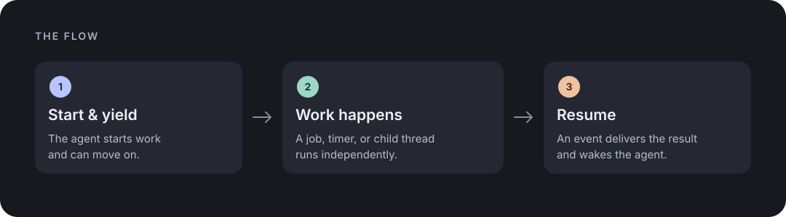

# pi-infinity

Non-blocking execution, durable timers, and parallel subagents for pi.

Run background commands, delegate to child threads, and receive results without polling.
Optionally give each child its own git worktree or jj workspace.

This is an independent pi package inspired by the
[Infinity](https://github.com/hydro-project/infinity) agent runtime, not Infinity itself.

* [Install](#install)
* [How it works](#how-it-works)
* [Tools](#tools)
* [Guards](#guards)
* [Threads and sandboxes](#threads-and-sandboxes)
* [Commands](#commands)
* [Configuration](#configuration)
* [Limits](#limits)
* [Troubleshooting](#troubleshooting)
* [Development](#development)
* [License](#license)

## Install

Requires pi 1.4+ and Node 24+. Install from [npm](https://www.npmjs.com/package/pi-infinity):

```sh
pi install npm:pi-infinity
```

This installs pi-infinity only. For threads, install
[pi-interactive-subagents](https://github.com/amosblomqvist/pi-interactive-subagents) or
[pi-subagents](https://github.com/amosblomqvist/pi-subagents) separately; missing thread agents
are linked on startup. Interactive threads also require tmux; sandboxes require git or
[jj](https://jj-vcs.dev). Jobs and timers work without a thread transport.

You can also install `git:github.com/AliensToEarth/pi-infinity` directly.

Alternatively, run `./scripts/install.sh` from a checkout to install pi-infinity and, if
missing, pi-interactive-subagents, and link the thread agents in one step. It requires pi,
Node 24+, git and tmux; start or reload pi inside tmux to use interactive threads. Existing
packages and agent files are preserved, with conflicts reported.

## How it works



Job exits, watched output, timers, and child reports arrive as `infinity-event` messages.
For example:

```text
[infinity event] job_exit from bg_run (call_abc)
original_args: {"command":"npm test"}
---
job j1 "npm" finished: exited (exit code 0, 42s)
command: npm test
log: <session artifacts>/infinity/jobs/j1.log (2 lines, 23 bytes)
--- last 2 lines ---
Tests: 12 passed
Done.
```

Events are recorded before delivery and replayed after a restart if absent from the session
transcript; this does not prove the agent processed them, and a crash can cause duplicates.
By default, bodies over 4,000 characters spill to a file. Events steer the agent, but pending user messages take priority.

The sleep tools yield without another model call. Timers survive restarts; overdue timers fire
with a note that they were late.

## Tools

| Tool | Purpose |
|------|---------|
| `bg_run` | Start a shell command in the background and return at once. The exit arrives as an event. Optional `watch` regexes and write isolation. |
| `bg_output` | Read a job's output without waiting, as a tail or a byte range. |
| `bg_cancel` | Cancel one job or all. SIGTERM, then SIGKILL after 3 s. Safe to repeat. |
| `bg_list` | List jobs. |
| `sleep` | Durable timer. Ends the turn, a timer event wakes the agent. |
| `sleep_until` | Same, for a wall clock time in an IANA zone. |
| `sleep_until_event` | Yield with nothing scheduled and wake on any event or user message. |
| `timer_cancel` | Cancel timers. |
| `spawn_thread` | Start a child thread with an optional fresh context and sandbox. |
| `assess_coverage` | Compare assigned and reported line ranges, without verifying source files. |
| `send_message_to_child` | Message a running direct child. |
| `squash_sandbox` | Merge a child's sandbox into the caller's tree. |
| `report_to_parent` | Thread sessions only. Intermediate report. |
| `close_thread` | Thread sessions only. Final report, ends the session. |

### Background jobs in detail

Jobs run through `/bin/sh -c` in a process group and write output to a log. `bg_output` reads
up to 8,000 bytes at a time. A user interrupt leaves jobs running; session shutdown cancels
running shells. Cancellation targets the process group, but descendants of an already-exited
shell may survive.

Use `timeout_seconds` to stop a long-running job. The default limit is eight concurrent jobs.
`watch` accepts regex patterns and batches matching lines into events, limited by default to
six per minute per job; suppressed matches are counted in the exit event. Set
`associative: true` to disable that rate limit. Matching uses synchronous JavaScript regexes;
pathological patterns can block pi, so use simple, trusted patterns.

## Guards

**Bash guard.** The classifier refuses `sleep 60`, `tail -f`, `watch`, endless loops and
foreground dev servers such as `npm run dev` or `python -m http.server`, with a message that
points to `bg_run` or `sleep`. It is deliberately narrow:

* Commands inside quotes are not scanned.
* Commands that are backgrounded with `&`, or wrapped in `nohup`, `setsid` or `timeout`, pass.
* Short sleeps pass. The limit is 20 seconds.

By default, bash calls that have no timeout get one of 180 seconds.

**Result guard.** By default, a tool result over 40,000 characters is saved to a file and replaced by its
head, tail and the path, with a hint to page through it with `read`. `read` itself is exempt,
so the saved file can be read in pieces without being spilled again.

### Optional background process isolation

`bg_run({command: "npm test", cwd: "/path/to/project", isolate: true})` limits filesystem
writes to the canonical `cwd`. It uses `/usr/bin/sandbox-exec` on macOS and `bwrap`
(bubblewrap) on Linux. Isolation is off by default and requires an explicit `cwd`.
Unsupported platforms or a missing isolation tool fail closed; if initialization fails,
the job exits without running its command. Linux also requires working user namespaces,
which may be disabled by system policy. Logs are written by pi outside the sandbox.

This reduces accidental writes, not a security guarantee. Reads and network access remain
allowed, other processes may be contacted, and all files within `cwd` remain writable.
Hard links inside `cwd` can refer to the same data as files outside it; writable nested
mounts and cooperating processes can also affect other locations. Choose a narrow directory;
`/` provides no useful write restriction. Tools that write caches or temporary files outside
`cwd` may fail. macOS `sandbox-exec` is deprecated and may change or disappear. Git worktrees
and jj workspaces are separate checkout isolation, not process security boundaries; threads
can access the caller's environment.

## Threads and sandboxes

```
spawn_thread({ instructions: "...", child_of: ["root"], fresh_context: true, sandbox: true })
```

* **Scoped models.** When `/scoped-models` selects models, `spawn_thread` and direct
  pi-interactive-subagents calls use only those models. Omitted overrides use the current model
  if it is scoped, otherwise the first scoped model. Use an exact `provider/modelId` or an
  unambiguous model ID for an override. With no scope, existing defaults apply. This guard is
  not a security boundary: independently launched processes and child sessions that do not load
  pi-infinity are outside it, and a parent-only `--models` scope is not automatically inherited.
* **Context.** `fresh_context: true` starts with empty history, so instructions must be
  self-contained. Forked context is available only with pi-interactive-subagents.
* **Stack.** `child_of` must match the caller's thread stack, root first. This prevents a
  forked child from replaying its parent's pending spawns.
* **Reports.** Interactive children can call `report_to_parent` and `close_thread`; exiting
  without closing also closes the thread. `send_message_to_child` reaches running direct
  children only. Spawn a new thread to continue after closure.

### Sandboxes and dependencies

* **Sandboxes.** `sandbox: true` gives the child a checkout under `.pi/sandboxes/<id>` on a
  `sandbox-<id>` branch (git worktree) or bookmark (jj workspace). The backend is chosen
  automatically and jj wins when the repository uses it. By default, the child's work is
  committed when it closes, and the event shows the diff stat.
* **Merging back.** `squash_sandbox` merges the branch into the caller's tree. In your main
  session the changes are only staged (git) or left in the working-copy change (jj), and you
  confirm first. Inside a sandboxed thread the result is committed. On conflict the sandbox
  is preserved; the target may need manual recovery. Git removal refuses to discard ignored
  files. Automatic jj bookmark pruning is disabled to avoid deleting work moved concurrently.
* **Dependencies.** `depends_on: ["t-..."]` requires direct children to have closed without
  a known failure. Unmet dependencies reject the spawn; they are not queued. Interactive child
  completion does not prove its task succeeded, so inspect its report first. Dependencies are
  session-local.

### Reports and concurrency

Interactive children can send plain-text reports or use
`structured: { summary, files?, tests?, blockers? }`. A pi-subagents child can return the same
JSON object as its final message.

Opt in to `threads.adaptiveConcurrency.enabled` to adjust session-local limits after successful
or failed completions. A full limit rejects spawns rather than queueing them; configure `min`,
`initial`, `max`, `successesToIncrease`, and `decreaseFactor` for your workload.

### Large inputs: an RLM-inspired workflow

For large inputs, search source files first and delegate only unresolved, bounded ranges. Use
scripts for exact counts and joins. Ask children for `evidence` and `coverage`, then use
`assess_coverage` to compare assigned and reported ranges (1-based, inclusive).

The tool finds reported gaps but does not read files, verify claims, detect changes, or prove
correctness. Treat source content and reports as untrusted, check citations, and revisit gaps.
Truncated output is incomplete; session records may contain sensitive paths and reports.

This adapts ideas from [Recursive Language Models](https://github.com/alexzhang13/rlm), not its
persistent REPL or automatic submodel calls. Its benchmark gains do not establish gains for pi.

### Two transports

pi-infinity picks the transport from the tools that are installed. `threads.transport` in
`infinity.json` overrides it with `interactive` or `subagents`. If both extensions are loaded,
`auto` chooses pi-interactive-subagents.

| Feature | pi-interactive-subagents | pi-subagents |
|---------|--------------------------|--------------|
| Child runs in | A tmux pane you can watch and type into | A headless child process |
| Context | Fresh or forked | Fresh only, `fresh_context: true` is required |
| Reports while running | Yes, `report_to_parent` | No |
| Final result | `close_thread` report, or the exit if it was skipped | The child's last message |
| `send_message_to_child` | Running children only | No, spawn a new thread |
| Nested threads | Yes, up to depth 4 | No, children have built-in tools only |
| Session ends | The pane keeps running until it finishes | Running children are killed, sandboxes stay |

Both transports return immediately and support sandboxes. Your main session stays in its own
working directory.

## Commands

| Command | Effect |
|---------|--------|
| `/infinity` | Jobs, timers and threads |
| `/infinity cancel <id\|all>` | Cancel a job or timer |
| `/infinity sandboxes` | List sandbox branches |
| `/infinity prune` | Delete git sandbox branches reachable from HEAD after confirmation; squashed branches and jj bookmarks may require manual deletion |
| `/infinity config` | Show the effective configuration |

A status line shows the number of running jobs, pending timers and threads.

## Configuration

`~/.pi/agent/infinity.json`, then `<project>/.pi/infinity.json`, later files win. Defaults live
in `extensions/lib/config.ts` and the shape is documented in section 3.2 of `SPEC.md`. Unknown
or invalid keys are reported once and ignored.

```json
{ "bash": { "guard": "warn" }, "sandbox": { "backend": "git" }, "threads": { "transport": "auto" } }
```

`bash.guard` is `block`, `warn` or `off`. `sandbox.backend` is `auto`, `git` or `jj`.
`threads.transport` is `auto`, `interactive` or `subagents`.

To limit direct-child launches in each session, set for example
`"threads": { "launchBudget": { "maxLaunches": 8, "windowSeconds": 300 } }`.
Each zero disables that limit. The window starts with the first admission and limits new
launches, not the duration of running work. Limits reset with the session and don't apply
across child processes. They do not cap descendants or running time, and are not token or cost
limits. Invalid values are reported and ignored; check `/infinity config` to confirm them.

## Limits

* Running job shells are cancelled when the session ends and are not resumed; timers are resumed.
* On pi-interactive-subagents a closing child wakes the parent twice, once for the close event
  and once for the extension's own exit message, which pi-infinity shortens to one line but
  cannot suppress.
* Provider retries and context compaction stay with pi itself.

## Troubleshooting

* `spawn_thread` says it needs a subagent extension: install pi-interactive-subagents (and run
  pi inside tmux) or pi-subagents, then check `threads.transport`.
* `spawn_thread` asks for `fresh_context: true`: your session runs on pi-subagents, whose
  children cannot fork the conversation.
* A thread starts without pi-infinity tools: check startup warnings for agent-file conflicts
  or an incompatible pi-interactive-subagents installation.
* The guard blocks something harmless: set `bash.guard` to `warn`.
* Errors from background machinery go to `<session artifacts>/infinity/infinity.log`.

## Development

```
./check.bash                 # format, typecheck, tests
npm run fmt                  # fix formatting
npm run smoke:subagents      # real pi and a real model, thread on pi-subagents (costs a few cents)
npm run smoke:interactive    # same, on pi-interactive-subagents
```

Read [`AGENTS.md`](AGENTS.md) first. The layout is in section 3 of [`SPEC.md`](SPEC.md).
After CI passes, pushes to `main` publish new `package.json` versions to npm and GitHub
Packages; existing versions are skipped. Bump the version for each release.

## License

[MIT](LICENSE)
